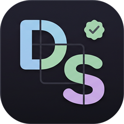

<p align="center">
  
</p>

<h1 align="center">Daily Sync</h1>

<p align="center">
  A Chrome extension that keeps a checklist of the daily puzzles you play,<br>
  ticks each one off as you finish it, and starts fresh at midnight.
</p>

<p align="center">
  <a href="https://raahilpattan.github.io/daily-sync/">Website</a> ·
  <a href="https://raahilpattan.github.io/daily-sync/privacy.html">Privacy policy</a> ·
  <a href="LICENSE">MIT License</a>
</p>

---

## What it tracks

| Game | Site |
|---|---|
| Wordle | nytimes.com/games/wordle |
| Connections | nytimes.com/games/connections |
| Strands | nytimes.com/games/strands |
| Globle | globle-game.com |
| Worldle | worldle.teuteuf.fr |
| Krillion | krillion.io |

You play the games on their own websites, the same way you normally do. Daily Sync watches those pages in the background and ticks a game off once you've finished today's puzzle. Wins and losses both count as finished.

---

## Install

> **Chrome Web Store:** coming soon. Once the listing is live, it will be linked here and on the [website](https://raahilpattan.github.io/daily-sync/), and that will be the easiest way to install.

Until then, install it from this repo:

1. **Download the code.** On this page, click the green **Code** button, then **Download ZIP**, and unzip it somewhere you'll keep it. If you use git, you can run `git clone https://github.com/raahilpattan/daily-sync.git` instead.
2. Open **`chrome://extensions`** in Chrome.
3. Turn on **Developer mode** (top-right switch).
4. Click **Load unpacked** and select the unzipped `daily-sync` folder (the one that contains `manifest.json`).
5. Click the puzzle-piece icon in Chrome's toolbar and **pin** Daily Sync so it's always visible.

Don't delete or move the folder afterwards, because Chrome loads the extension from it. To update, download the new code over the old folder and click the reload icon on the extension's card in `chrome://extensions`.

---

## How to use it

### My Games tab

- **Just play.** Open a game from the list (or go to the site directly) and finish today's puzzle. Within a few seconds the game turns into a ✓ in the popup.
- **The badge** on the toolbar icon shows how many games you have left today. It changes to ✓ once you've finished all six.
- **The progress bar** fills up as you go.
- **Your score** (for example *Solved · 4/6*) appears under the game once Daily Sync can read it. For Connections and Strands, click the game's own **Share** button to record your score.
- **Click the circle** next to a game to mark it done yourself, for example if you played on your phone. Click it again to undo.
- **Click the game's name** to open it in a new tab.
- **Midnight reset:** at local midnight the list clears for the next day. If your computer was asleep at midnight, the list resets the next time you open Chrome. Your history is kept, so streaks carry on.

### Hiding and reordering games

Don't play some of them? Click **Edit** next to the progress bar.

- Click the **eye** on a game to hide it. Hidden games drop out of the list, the badge and the progress bar, so "3/5" means 3 of *your* 5.
- Drag the **⋮⋮** handle to reorder, or focus it and use the ↑/↓ keys.
- Click **Done** when you're finished. Hidden games stay in the Edit view, so you can bring them back any time.

Your list is saved to your Chrome profile, so it follows you to other computers where you're signed in to Chrome.

### Stats tab

- **Streak** 🔥: how many days in a row you've finished at least one puzzle. It also shows next to your progress bar. Until you play today, the streak counts through yesterday, and the chip turns grey as a reminder.
- **Best streak** and **perfect days** (days you finished every game in your list).
- **Calendar:** the last 16 weeks. The brighter the square, the more of your list you finished that day.
- **Per game:** days played, current and best streak, and your average, for example *avg 3.9/6* for Wordle or *avg 0.4 mistakes* for Connections.

History is kept for about 13 months, and only in your browser. It starts from the day you install this version.

### Friends tab (optional)

Tracking works without an account. The Friends tab is only for comparing progress with other people.

1. Open the **Friends** tab and click **Sign in with Google**.
2. You'll get a 6-character **friend code**. Click it to copy it and send it to a friend.
3. To add someone, type their **friend code** or the **email they signed in with** into the box and click **Add**.
4. **They have to add you back.** Until they do, they appear under *"Waiting for them to add you back"*, and neither of you can see the other's progress.
5. Once you've added each other, the leaderboard shows who has finished how many games today, with one dot per game in their list, and their 🔥 streak. Click ↻ to refresh it.

Everyone is scored out of their own list, so someone who hides two games shows as "3/4", not "3/6". Ranking goes by games finished, then by how much of their list they've done, then by who finished first.

#### Comparing results (no spoilers)

Click a friend on the leaderboard to see the games they've finished today:

- For games **you've also finished**, you see their score and emoji grid, for example *Wordle 3/6* with the coloured squares, or *Connections · 1 mistake*.
- For games **you haven't finished yet**, their result stays hidden and shows **Play it to see**. Click that to open the game. Their result unlocks as soon as you finish it.

The grids are the same spoiler-free squares the games put in their own Share text. No words or answers are ever stored. The lock is enforced by the database rules, not just hidden in the popup.

How each game's score is captured:

| Game | Score shown | Where it comes from |
|---|---|---|
| Wordle | 4/6 + grid | Read automatically from the board |
| Worldle | 3/6 | Read automatically from your guesses |
| Globle | 12 guesses | Read automatically from your guesses |
| Krillion | Score | Read automatically from the site's saved stats |
| Connections | 1 mistake + grid | Click the game's **Share** button |
| Strands | No hints + grid | Click the game's **Share** button |

Clicking a game's own Share button always records your score and grid, including for the first four.

To leave, use **Sign out** at the bottom of the tab. **Delete account** (click it twice to confirm) permanently removes your profile, friend list and stats from the server.

Sign-in uses Chrome's built-in Google account support, so it only works in **Google Chrome**. Other Chromium browsers such as Brave, Edge and Arc don't support it. Game tracking still works in those browsers.

---

## Troubleshooting

**A game didn't tick after I finished it.**
First, close and reopen the popup, and make sure you finished *today's* puzzle (not an archive one). If it still isn't ticked, click its circle to mark it done yourself. Sites sometimes change how they save progress. If you'd like to help fix it, follow [Debugging a detector](#debugging-a-detector) and open an issue with the console output.

**Connections or Strands didn't tick.**
These are the least certain detectors, because the NYT doesn't save them in a stable format. Reports are especially welcome.

**A friend's result just says "Solved" with no score.**
They finished it without Daily Sync seeing a score. Connections and Strands only record one when the player clicks the game's Share button.

**Krillion reset at an odd time.**
Krillion's new puzzle comes out at midnight New York time, but Daily Sync resets at *your* local midnight. If you live outside US Eastern time, the two can be a few hours apart.

**"Sign in" does nothing or shows an error.**
Make sure you're in Google Chrome and signed in to Chrome with a Google account. If the message mentions access being blocked, the sign-in setup is still waiting on Google's review. Please open an issue.

**The Friends tab says "isn't set up yet".**
You're running a fork without its own Firebase and Google sign-in configuration. See [Run your own backend](#run-your-own-backend).

---

## Privacy

- **Tracking happens entirely in your browser.** Your daily history for streaks and stats stays there too. The extension only runs on the six game sites listed above. It stores whether each game is finished today, plus your score and emoji grid. When you click a game's own Share button, it keeps only the score and emoji lines from the shared text.
- **Nothing is uploaded unless you sign in** to Friends. If you do, it stores your Google name, email, profile photo, friend code, friend list and daily results, which games are in your list and your current streak, so that friends you've *both* added can see them. A friend only sees your score for a game once they've finished it too.
- You can delete all of it at any time with **Delete account**.

Full details are in the [privacy policy](https://raahilpattan.github.io/daily-sync/privacy.html).

Daily Sync is an independent project. It is not affiliated with The New York Times, Globle, Worldle (teuteuf) or Krillion.

---

## For developers

### How it works

| File | Role |
|---|---|
| `content/page-hook.js` | Runs in the page's MAIN world and wraps `localStorage.setItem`, so the tracker knows the moment a game saves its state. The `storage` event can't be used for this, because it only fires in *other* tabs. It also wraps `navigator.clipboard.writeText`, `navigator.share` and `execCommand('copy')`, so the game's own Share text reaches the content script. |
| `content/common.js` | `DailyTracker` helpers and the watcher loop. It re-runs detection on storage writes, DOM changes, page load and a 15 s poll, then sends one message to the worker. |
| `content/games/*.js` | One detector per game. Each tries the game's known localStorage format first, then DOM signals (the board or a results modal), then a generic scan for things like `status: "WIN"` and `solved: true`. A detector can also return a `detail` (`{ summary, grid }`), and can define `parseShare(text)` to turn the game's Share text into one. |
| `background.js` | Service worker, and the only writer to `chrome.storage.local`. It runs a one-shot alarm at local midnight that clears the day and re-arms itself. Every read also checks the date, so a missed alarm can't leave yesterday's ticks behind. |
| `popup.*`, `friends.js` | The popup UI. It updates live through `chrome.storage.onChanged`. `friends.js` only messages the service worker and renders what comes back. |
| `shared/games.js` | The list of games (name, URL, colour, tag), plus the user's list settings: `normalizePrefs`, `orderedGames`, `visibleGames`. Settings live in `chrome.storage.sync` under `prefs` as `{ order, hidden }`. |
| `shared/history.js` | Daily history (`chrome.storage.local` → `history`, about 400 days), and streaks, perfect days, averages and calendar data built from it. |
| `shared/firebase.js`, `shared/social.js` | Google sign-in, a small Firebase Auth and Firestore REST client, and the friends and leaderboard logic. They run only in the service worker. |
| `firestore.rules` | Server-side access rules. Friendship is enforced as mutual here, so knowing someone's email isn't enough to see their stats. |

A "won" state only counts if it carries today's date, or if it has no date and the page wrote it just now. That stops yesterday's leftover state from ticking today's box.

The extension uses Firebase over REST rather than the Firebase JS SDK. MV3 bans remotely hosted code, so the SDK would need an npm bundling step. The Firestore SDK also needs `XMLHttpRequest`, which MV3 service workers don't have. The REST calls go through the same security rules.

Permissions: `storage`, `alarms` and `identity`. Content scripts only match the six game URLs.

Result details never contain letters. `emojiGrid()` keeps only emoji lines without letters, and `background.js` applies the same filter again before anything is stored or uploaded.

### Debugging a detector

1. Open the game and finish (or load) today's puzzle.
2. In DevTools → Console, run `localStorage.setItem('dgt-debug', '1')` and reload the page.
3. The console logs a localStorage snapshot and every detection pass, tagged `[DailyTracker]`.
4. Patch `content/games/<game>.js` at the `👉 PATCH HERE` comment, then click reload on the extension in `chrome://extensions`.

How reliable each detector is:
- **Globle, Worldle:** known formats (`statistics.lastWin`; `guesses["YYYY-MM-DD"]` with `distance === 0`).
- **Wordle:** the `nyt-wordle-moogle/*` or `nyt-wordle-state` status, plus reading the board tiles.
- **Krillion:** `krillion:stats:v1` → `history["YYYY-MM-DD"]`, using the New York date. Also checks the "Dive #N complete" text.
- **Connections, Strands:** DOM signals ("Next puzzle in", "View Results") plus the generic scanner. These are the most likely to break. Their scores come from the Share text, which has a stable format.

### Adding a new game

1. Add an entry to `GAMES` in `shared/games.js`.
2. Create `content/games/<id>.js` that calls `DailyTracker.register('<id>', detect, { parseShare })`. Copy an existing detector as a starting point.
3. In `manifest.json`, add a `content_scripts` entry for the game's URL, and add the same URL to the `page-hook.js` entry.
4. Add the site to the host list in `store/LISTING.md` and `docs/privacy.html`.

Issues and pull requests are welcome, especially detector fixes and new daily games.

### Run your own backend

`firebase-config.js` and `oauth2.client_id` in `manifest.json` point at this project's Firebase and Google sign-in. You can load them as-is for local development. The manifest's `"key"` pins the unpacked extension ID to `dcklimnifkhdpgnopgcfoncjpihpnhgp` so that the existing OAuth client works for everyone.

If you publish your own fork, set up your own backend:

1. **Firebase:** in the [Firebase console](https://console.firebase.google.com/), create a project.
   - Go to **Authentication → Sign-in method** and enable **Google**.
   - Create a **Firestore** database in production mode, then paste [`firestore.rules`](firestore.rules) into **Rules** and click **Publish**.
   - Under **Project settings → Your apps**, add a **Web app** and copy `apiKey`, `authDomain` and `projectId` into `firebase-config.js`.
2. **OAuth client:** in the [Google Cloud Console](https://console.cloud.google.com/), select the **same project** Firebase created.
   - Set up **Google Auth Platform** (External, with the `userinfo.email` and `userinfo.profile` scopes). While it's in Testing, add yourself as a test user.
   - Go to **Clients → Create client → Chrome Extension** and enter your extension's ID.
   - Put the client ID into `manifest.json` → `oauth2.client_id`.
3. Remove or replace `"key"` in `manifest.json`, so your extension gets its own ID.

None of these values are secrets, because access is controlled by `firestore.rules`.

Firestore schema:
```
users/{uid}                          { uid, displayName, email, photoURL, friendCode, createdAt, updatedAt }
users/{uid}/dailyStats/{YYYY-MM-DD}  { date, completed: { wordle: { at }, … }, tracked: [ids], count, total, streak, updatedAt }
users/{uid}/dailyStats/{date}/results/{gameId}
                                     { game, result, summary, grid, at }       ← readable by a friend only if they finished that game that day
users/{uid}/friends/{friendUid}      { uid, displayName, photoURL, addedAt }   ← people this user added
friendCodes/{CODE}                   { uid, displayName, photoURL }            ← lookup by code (get only)
emailIndex/{email}                   { uid, displayName, photoURL }            ← lookup by exact email (get only)
```

### Publishing

- `docs/` holds the website and privacy policy, served by GitHub Pages.
- `scripts/build-store.ps1 -ClientId <store client id>` builds the Web Store zip into `dist/`. It strips `"key"` and swaps in the store's OAuth client.
- `scripts/make-icons.ps1` regenerates every icon from `store/logo-source.jpg`.
- `store/LISTING.md` has the listing text, permission justifications, privacy-form answers and the launch checklist.

---

## License

[MIT](LICENSE) © 2026 Raahil Pattan. Questions or feedback: [raahil.pattan@gmail.com](mailto:raahil.pattan@gmail.com) or [open an issue](https://github.com/raahilpattan/daily-sync/issues).
